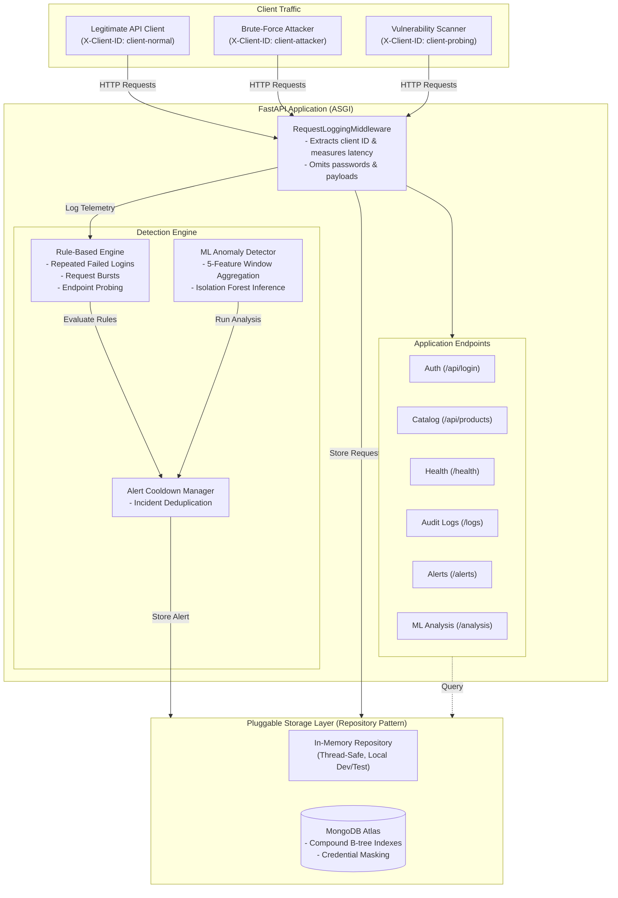

# API Sentinel — API Abuse & Anomaly Detection Platform

A backend-first API security monitoring system built with Python, FastAPI, and scikit-learn. API Sentinel records safe request telemetry, evaluates traffic against deterministic abuse rules and unsupervised Isolation Forest anomaly detection, deduplicates security incidents, and persists audit logs and alerts to in-memory storage or hosted MongoDB Atlas.

---

## 1. Problem Statement & Architecture

Modern web APIs frequently encounter malicious automated traffic, including credential stuffing, scraping bursts, and vulnerability scanning. Traditional network firewalls often lack application-layer context, while rigid threshold rules can be bypassed by low-and-slow multi-vector attacks.

API Sentinel addresses this with a hybrid defense model:
1. **Safe Telemetry Middleware**: Records request metadata (client ID, path, status, latency) while strictly discarding request bodies, authorization headers, and credentials.
2. **Deterministic Rule Engine**: Instantly flags high-confidence policy violations (repeated failed logins, rapid request bursts, and 404 endpoint fuzzing) with zero false positives.
3. **Unsupervised ML Anomaly Detection**: Uses scikit-learn's `IsolationForest` across a 5-dimensional client observation window to catch multi-vector behavioral anomalies that stay below individual rule thresholds.
4. **Pluggable Persistence**: Decouples application logic from data storage using the Repository Pattern, supporting zero-dependency in-memory storage and production MongoDB Atlas clustering with automated B-tree indexing.

### System Architecture Diagram



---

## 2. Technology Stack

- **Framework**: Python 3.11+, FastAPI (ASGI), Uvicorn, Starlette
- **Configuration**: Pydantic Settings & Pydantic v2
- **Machine Learning**: scikit-learn (Isolation Forest), NumPy, Joblib
- **Database**: MongoDB Atlas, PyMongo, dnspython (SRV connection pooling)
- **Testing & Verification**: Pytest, HTTPX, FastAPI TestClient
- **Packaging**: Docker (Python 3.11 slim, non-root user UID 1001), Docker Compose

---

## 3. Project Structure

```text
api-sentinel/
├── app/
│   ├── main.py                   # FastAPI application entrypoint & middleware mounting
│   ├── core/
│   │   └── config.py             # Application settings & threshold configuration (Pydantic)
│   ├── database/
│   │   └── mongodb.py            # MongoDBManager, Atlas connection pooling, URI masking, indexes
│   ├── middleware/
│   │   └── logging.py            # Non-intrusive request logging & abuse detection trigger
│   ├── ml/
│   │   ├── detector.py           # AnomalyDetector service, Isolation Forest inference, alerts
│   │   └── features.py           # Feature extraction from RequestLog windows
│   ├── models/
│   │   ├── alert.py              # Security Alert schema, severity, and status definitions
│   │   ├── auth.py               # Authentication schemas & mock test credentials
│   │   ├── log.py                # Safe RequestLog telemetry schema
│   │   └── product.py            # Product catalog schema & mock data
│   ├── repositories/
│   │   ├── alert_repository.py   # BaseAlertRepository, InMemoryAlertRepository & MongoAlertRepository
│   │   └── log_repository.py     # BaseLogRepository, InMemoryLogRepository & MongoLogRepository
│   ├── routes/
│   │   ├── alerts.py             # GET /alerts & GET /alerts/{id}
│   │   ├── analysis.py           # GET /analysis/status & POST /analysis/run
│   │   ├── auth.py               # POST /api/login endpoint
│   │   ├── logs.py               # GET /logs audit endpoint
│   │   └── products.py           # GET /api/products & GET /api/products/{id}
│   └── rules/
│       ├── base.py               # BaseRule interface definition
│       ├── engine.py             # AbuseDetectionEngine & cooldown deduplication
│       ├── endpoint_probing.py   # EndpointProbingRule (directory scans / 404 fuzzing)
│       ├── failed_logins.py      # RepeatedFailedLoginsRule (brute-force attacks)
│       └── request_burst.py      # RequestBurstRule (traffic spikes / scraping)
├── models/
│   ├── isolation_forest.joblib   # Trained Isolation Forest model artifact (scikit-learn)
│   └── model_metadata.json       # Hyperparameters, feature schema, and disclaimer
├── reports/
│   ├── simulation_manifest.json  # Manifest of simulated traffic scenarios
│   ├── evaluation_results.json   # Full benchmark evaluation output (held-out & live)
│   └── evaluation_metrics.csv    # Tabular metric export (Precision, Recall, F1, FPR, CM)
├── scripts/
│   ├── train_isolation_forest.py # Synthetic normal baseline generator & model trainer
│   ├── simulate_traffic.py       # Standalone multi-scenario traffic generator
│   └── evaluate_detection.py     # Benchmark evaluator (Held-out test set & Live traffic)
├── tests/
│   ├── conftest.py               # Test fixtures & storage isolation
│   ├── test_alerts_api.py        # /alerts endpoints & live detection triggers
│   ├── test_api.py               # Auth, products, headers, and safe logging
│   ├── test_docker_and_deployment.py # Dockerfile, .dockerignore, error handlers, settings
│   ├── test_evaluation.py        # Benchmark metrics formulas & zero-denominator safety
│   ├── test_health.py            # /health, OpenAPI docs, and configuration
│   ├── test_ml.py                # Feature extraction, synthetic trainer, /analysis endpoints
│   ├── test_mongo.py             # URI masking, connection failure & Mongo repositories
│   └── test_rules.py             # Deterministic unit tests for rules & cooldown
├── .dockerignore                 # Excludes .env, .git, .venv, caches, and logs
├── .env.example                  # Template configuration with safe placeholders
├── .gitignore                    # Excludes venvs, caches, .env, and local model binaries
├── Dockerfile                    # Production container specification (Python 3.11 slim)
├── docker-compose.yml            # Local container orchestration file
├── requirements.txt              # Project dependencies
└── README.md                     # Documentation & setup guide
```

---

## 4. Key Features & Detection Mechanisms

### A. Data Minimization & Safe Logging
- Never stores passwords, tokens, query credentials, or request bodies.
- Records safe telemetry: `timestamp` (UTC), `client_id` (via `X-Client-ID` header or default), `method`, `path`, `status_code`, and `process_time_ms`.
- Each request is logged exactly once upon completion.

### B. Rule-Based Abuse Detection
- **Repeated Failed Logins**: Flags clients with $\ge 5$ HTTP 401 login attempts within a 60-second window. Target: credential stuffing.
- **Request Burst**: Flags clients with $\ge 30$ requests within a 10-second window. Target: scrapers and traffic floods.
- **Endpoint Probing**: Flags clients accessing $\ge 5$ distinct paths with $\ge 3$ HTTP 404 responses within 60 seconds. Target: directory traversal and vulnerability scanning.
- **Alert Deduplication**: Enforces a 60-second cooldown window per client and rule to prevent alert fatigue.

### C. ML-Based Anomaly Detection
- Aggregates recent request logs per client over a 300-second window into 5 metrics:
  1. `request_count`: Total requests in window.
  2. `failed_login_count`: Total HTTP 401 failures on `/api/login`.
  3. `error_4xx_proportion`: Ratio of 4xx responses to total requests ($[0.0, 1.0]$).
  4. `distinct_paths_count`: Cardinality of distinct paths accessed.
  5. `not_found_count`: Total HTTP 404 Not Found responses.
- Uses **scikit-learn Isolation Forest** (`contamination=0.05`, `n_estimators=100`, `random_state=42`) trained on synthetic legitimate traffic.
- Identifies multi-dimensional deviations that individually fall below rule thresholds.
- Enforces an independent 300-second ML alert cooldown.

---

## 5. Local Setup & Execution

### 1. Environment Setup

```bash
# Clone the repository
git clone https://github.com/your-username/api-sentinel.git
cd api-sentinel

# Create and activate a virtual environment
python -m venv .venv
# On Windows:
.\.venv\Scripts\Activate.ps1
# On Linux/macOS:
source .venv/bin/activate

# Install dependencies
pip install -r requirements.txt

# Copy configuration template
cp .env.example .env
```

### 2. Run the Application

```bash
uvicorn app.main:app --reload --host 127.0.0.1 --port 8000
```
Access the Swagger UI at `http://127.0.0.1:8000/docs`.

---

## 6. Environment Variables Reference

| Variable | Type | Default | Description |
| :--- | :---: | :--- | :--- |
| `PROJECT_NAME` | string | `API Sentinel` | Service display name. |
| `ENVIRONMENT` | string | `development` | Deployment environment (`development`, `production`). |
| `DEBUG` | boolean | `true` (dev) / `false` (prod) | Toggles verbose error traces. |
| `HOST` | string | `127.0.0.1` | Local listening host (`0.0.0.0` in container). |
| `PORT` | integer | `8000` | Listening port (overridden by cloud hosts). |
| `STORAGE_BACKEND` | string | `memory` | Storage backend (`memory` or `mongodb`). |
| `MONGODB_URI` | string | `None` | MongoDB Atlas SRV connection string. |
| `MONGODB_DATABASE`| string | `api_sentinel` | Target MongoDB database name. |
| `FAILED_LOGIN_THRESHOLD` | integer | `5` | Failed logins required to trigger rule. |
| `FAILED_LOGIN_WINDOW_SECONDS` | integer | `60` | Observation window for failed logins. |
| `BURST_REQUEST_THRESHOLD` | integer | `30` | Request count required to trigger burst rule. |
| `BURST_WINDOW_SECONDS` | integer | `10` | Observation window for request bursts. |
| `PROBING_DISTINCT_PATHS_THRESHOLD` | integer | `5` | Distinct paths threshold for probing rule. |
| `PROBING_404_THRESHOLD` | integer | `3` | 404 response threshold for probing rule. |
| `PROBING_WINDOW_SECONDS` | integer | `60` | Observation window for endpoint probing. |
| `ALERT_COOLDOWN_SECONDS` | integer | `60` | Cooldown period between duplicate rule alerts. |
| `ML_MODEL_PATH` | string | `models/isolation_forest.joblib` | Path to serialized ML model. |
| `ML_METADATA_PATH` | string | `models/model_metadata.json` | Path to ML model metadata. |
| `ML_OBSERVATION_WINDOW_SECONDS` | integer | `300` | Time window for client feature aggregation. |
| `ML_CONTAMINATION` | float | `0.05` | Expected outlier proportion in training data. |
| `ML_RANDOM_STATE` | integer | `42` | Deterministic random seed for training. |
| `ML_ALERT_COOLDOWN_SECONDS` | integer | `300` | Cooldown period between duplicate ML alerts. |

---

## 7. MongoDB Atlas Setup Guide

To enable persistent storage across restarts:

1. **Deploy a Free Cluster**: Sign in to [MongoDB Atlas](https://www.mongodb.com/atlas) and deploy an **M0 Free Cluster**.
2. **Create Database User**: Under **Database Access**, create a user with **Read and write to any database** (or scoped to `api_sentinel`).
3. **Configure IP Access**: Under **Network Access**, add `0.0.0.0/0` (Allow Access from Anywhere) for container PaaS compatibility. Atlas protects access via TLS and username/password authentication.
4. **Copy Connection String**: Click **Connect** -> **Drivers** (Python), copy the SRV URI, and configure `.env`:
   ```bash
   STORAGE_BACKEND="mongodb"
   MONGODB_URI="mongodb+srv://<username>:<password>@cluster0.example.mongodb.net/?retryWrites=true&w=majority"
   MONGODB_DATABASE="api_sentinel"
   ```
5. **Automated Compound Indexes**: On startup, API Sentinel automatically provisions:
   - `request_logs`: `idx_logs_id_unique`, `idx_logs_timestamp_desc`, `idx_logs_client_timestamp`
   - `security_alerts`: `idx_alerts_id_unique`, `idx_alerts_timestamp_desc`, `idx_alerts_client_rule_timestamp`, `idx_alerts_status`

---

## 8. ML Model Training & Traffic Simulation

### 1. Train the ML Isolation Forest Model
Model training is decoupled from application runtime. Train the model using the deterministic baseline generator:

```bash
python scripts/train_isolation_forest.py --output-dir models --samples 1500 --seed 42 --contamination 0.05
```

Artifacts saved to `models/`:
- `isolation_forest.joblib`: Serialized model file.
- `model_metadata.json`: Hyperparameters, feature schema, and disclaimer.

### 2. Generate Simulated Traffic
Run the standalone traffic simulator against the running API:

```bash
python scripts/simulate_traffic.py --base-url http://127.0.0.1:8000 --output reports/simulation_manifest.json
```

Simulates 6 distinct client scenarios:
- `client-normal-alpha`: Normal product catalog browsing and health checks.
- `client-normal-beta`: Normal user authentication and product viewing.
- `client-brute-force`: 7 consecutive failed login attempts on `/api/login`.
- `client-request-burst`: 35 rapid requests in <1 second without delay.
- `client-endpoint-probing`: 10 distinct non-existent sensitive endpoints (`/.env`, `/admin.php`, `/wp-admin`).
- `client-mixed-abuse`: Multi-vector activity combining browsing, probing, and failed logins.

---

## 9. Evaluation Methodology & Empirical Results

The benchmark evaluator (`scripts/evaluate_detection.py`) measures detector performance against known ground-truth labels across three engines:
- **Rule-Based Detector**: Static security thresholds.
- **ML Anomaly Detector**: Unsupervised Isolation Forest.
- **Combined Hybrid Detector**: Flags incident if either Rule or ML detector triggers.

### Evaluation Commands:
```bash
# Evaluate both held-out test set and live traffic:
python scripts/evaluate_detection.py --mode both

# Evaluate held-out synthetic test set only:
python scripts/evaluate_detection.py --mode held-out

# Evaluate live simulated traffic only:
python scripts/evaluate_detection.py --mode live --manifest reports/simulation_manifest.json
```

### Empirical Results (Held-Out Test Set: 700 Windows, Seed 2026)

| Detector | Precision | Recall | F1 Score | False Positive Rate | TP | FP | TN | FN |
| :--- | :---: | :---: | :---: | :---: | :---: | :---: | :---: | :---: |
| **Rule-Based Detection** | **1.0000** | 0.7400 | 0.8506 | **0.0000** | 148 | 0 | 500 | 52 |
| **ML Anomaly Detection** | 0.8571 | 0.7500 | 0.8000 | 0.0500 | 150 | 25 | 475 | 50 |
| **Combined Hybrid Detection** | 0.8889 | **1.0000** | **0.9412** | 0.0500 | 200 | 25 | 475 | **0** |

### Key Trade-Off Insights:
1. **Rule Precision**: Rule-based detection achieves zero false positives ($\text{FPR} = 0.0\%$), but misses multi-vector attacks where individual metrics remain just below static thresholds ($\text{Recall} = 74.0\%$).
2. **ML Generalization**: Isolation Forest captures multi-dimensional anomalies without pre-configured thresholds, but incurs a $5.0\%$ false positive rate reflecting the baseline training contamination parameter.
3. **Hybrid Ensemble**: Combining both detectors yields $100\%$ attack recall ($\text{F1} = 0.9412$) by pairing deterministic policy enforcement with statistical anomaly detection.

> [!WARNING]
> Synthetic benchmark evaluation demonstrates relative detector trade-offs under synthetic assumptions and does not establish production accuracy against sophisticated real-world adversaries.

---

## 10. API Examples

### 1. Health Check
```bash
curl -s http://127.0.0.1:8000/health
```
```json
{
  "status": "healthy",
  "app_name": "API Sentinel",
  "environment": "development",
  "version": "0.1.0"
}
```

### 2. Simulated Login
```bash
curl -s -X POST http://127.0.0.1:8000/api/login \
  -H "Content-Type: application/json" \
  -H "X-Client-ID: client-demo" \
  -d '{"username": "admin", "password": "wrongpassword"}'
```
```json
{
  "detail": "Invalid username or password"
}
```

### 3. Retrieve Audit Logs
```bash
curl -s "http://127.0.0.1:8000/logs?limit=2"
```
```json
[
  {
    "id": "89476d1c-acc7-490d-9fc8-f14b05b6cdb8",
    "timestamp": "2026-10-12T07:46:21.290954Z",
    "client_id": "client-mixed-abuse",
    "method": "POST",
    "path": "/api/login",
    "status_code": 401,
    "process_time_ms": 1.36
  }
]
```

### 4. Trigger ML Anomaly Analysis
```bash
curl -s -X POST http://127.0.0.1:8000/analysis/run
```
```json
{
  "status": "completed",
  "observation_window_seconds": 300,
  "clients_analyzed": 6,
  "anomalies_detected": 3,
  "alerts_created": 3
}
```

### 5. Retrieve Security Alerts
```bash
curl -s "http://127.0.0.1:8000/alerts?limit=1"
```
```json
[
  {
    "id": "e2158e24-9510-475f-a62e-ee9e7d507a76",
    "timestamp": "2026-10-12T07:46:21.153836Z",
    "client_id": "client-mixed-abuse",
    "rule_name": "Endpoint Probing",
    "severity": "high",
    "reason": "Client 'client-mixed-abuse' accessed 6 distinct paths with 3 404 responses within 60s.",
    "status": "open"
  }
]
```

---

## 11. Docker Packaging & Local Usage

The application includes a production-ready `Dockerfile` and `docker-compose.yml`:
- **Lightweight & Secure**: Based on `python:3.11-slim`, executed as non-root user `appuser` (UID 1001).
- **Embedded Health Check**: Standard library `urllib.request` probe on `/health`.
- **Dynamic Port**: Binds to `0.0.0.0` and respects the `${PORT}` environment variable.

```bash
# Build Docker image
docker build -t api-sentinel:latest .

# Run with in-memory storage
docker run -d -p 8000:8000 --name api-sentinel -e ENVIRONMENT=production -e DEBUG=false api-sentinel:latest

# Run with MongoDB Atlas
docker run -d -p 8000:8000 --name api-sentinel \
  -e ENVIRONMENT=production \
  -e DEBUG=false \
  -e STORAGE_BACKEND=mongodb \
  -e MONGODB_URI="mongodb+srv://<user>:<pass>@cluster0.example.mongodb.net/?retryWrites=true&w=majority" \
  api-sentinel:latest

# Or run with Docker Compose
docker compose up -d
```

---

## 12. Cloud Deployment Guide & Status

API Sentinel is container-compatible and prepared for deployment to serverless container hosts such as **Render**, **Railway**, or **Google Cloud Run**:

### Deployment Steps (e.g., Render):
1. Create a new **Web Service** and connect your repository.
2. Select **Docker** as the environment.
3. Configure Environment Variables in the hosting dashboard:
   - `ENVIRONMENT` = `production`
   - `DEBUG` = `false`
   - `STORAGE_BACKEND` = `mongodb`
   - `MONGODB_URI` = `mongodb+srv://<username>:<password>@cluster0.example.mongodb.net/?retryWrites=true&w=majority`
4. Set the Health Check path to `/health`.
5. Deploy and verify `/health` and `/docs`.

### Deployment Status:
- **Prepared & Tested Locally**: Container specification, environment variable overrides, URI credential masking, and error handlers are tested and verified.
- **Live Cloud Deployment**: Not deployed to a public cloud URL; execution stopped at the manual account creation and billing boundary.

---

## 13. Running Automated Tests

```bash
pytest -v
```

All 86 tests execute in <11s:
- **`tests/test_docker_and_deployment.py`** (7 tests): Dockerfile directives, non-root user, `.dockerignore`, error handlers, and settings overrides.
- **`tests/test_evaluation.py`** (6 tests): Metric formulas, zero-denominator safety, held-out test generation, and live simulation evaluation against the API.
- **`tests/test_ml.py`** (20 tests): Feature extraction, synthetic normal trainer, model serialization, 503 handling, ML alert cooldown, and `/analysis` endpoints.
- **`tests/test_mongo.py`** (12 tests): URI credential masking, missing/empty/placeholder URI validation, unreachable server handling, write failure error raising, and conditional live Atlas tests.
- **`tests/test_rules.py`** (11 tests): Deterministic unit tests for all 3 detection rules and cooldown deduplication.
- **`tests/test_alerts_api.py`** (9 tests): Endpoints `GET /alerts`, `GET /alerts/{id}`, filtering, and end-to-end detection triggers.
- **`tests/test_api.py`** (15 tests): Authentication, products catalog, client headers, and safe logging.
- **`tests/test_health.py`** (6 tests): Service health, configuration, and documentation metadata.

---

## 14. Known Limitations & Future Improvements

1. **Unsupervised Statistical Baseline**: Isolation Forest flags statistical deviations, not confirmed malicious intent. In production, this requires periodic retraining or baseline drift monitoring.
2. **Monitoring-Only Architecture**: The current architecture records and alerts on suspicious activity without inline blocking or active rate limiting.
3. **In-Memory Distributed Limitations**: In multi-instance container deployments without MongoDB, in-memory log repositories are isolated per container replica. MongoDB Atlas must be used for distributed multi-replica deployments.
4. **Future Roadmap**:
   - Streaming event pipeline (Kafka or Redis Streams) for horizontal scaling.
   - Dynamic IP blocklist integration (e.g., Cloudflare or AWS WAF API webhooks).
   - Supervised fine-tuning based on security analyst feedback.
